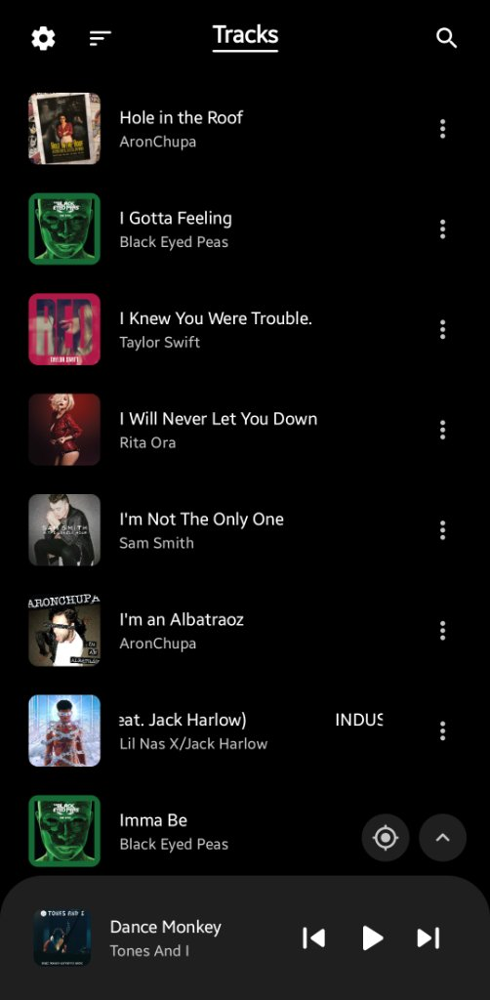
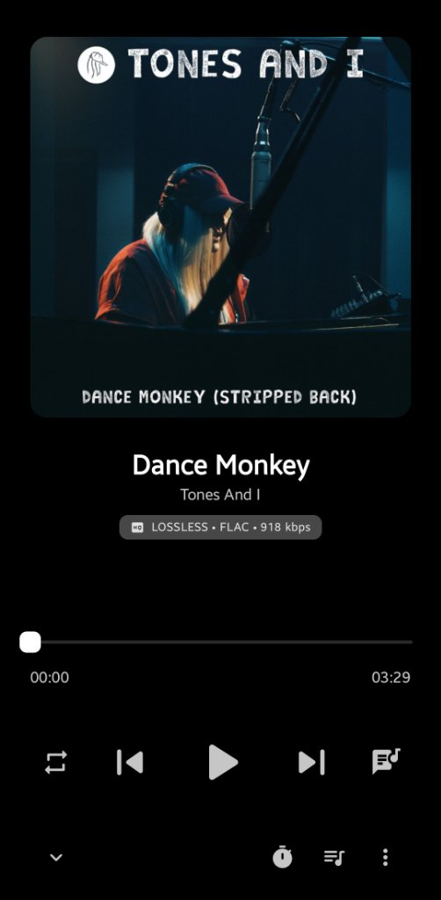
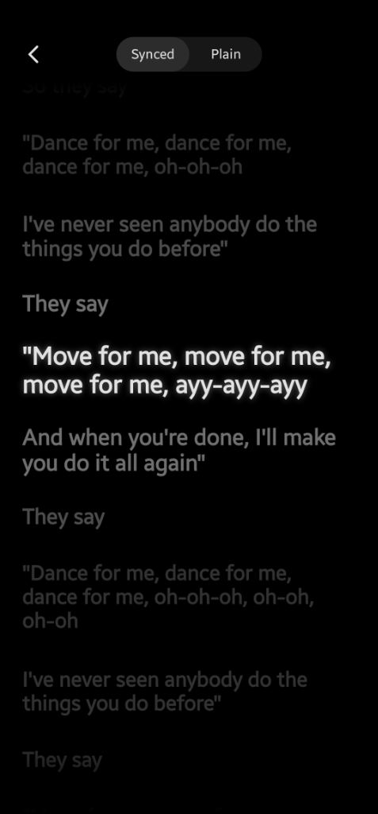
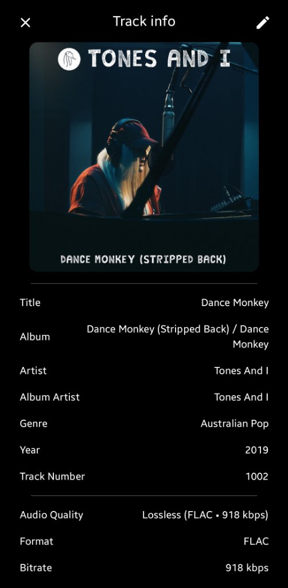
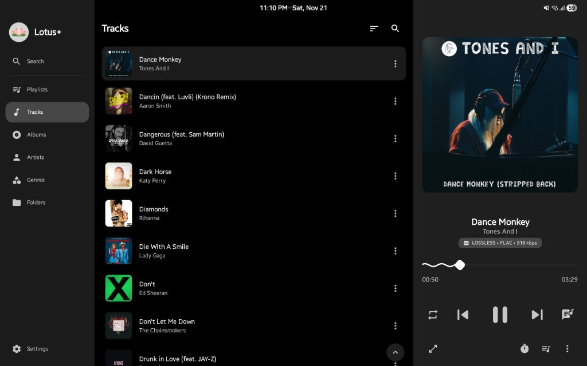
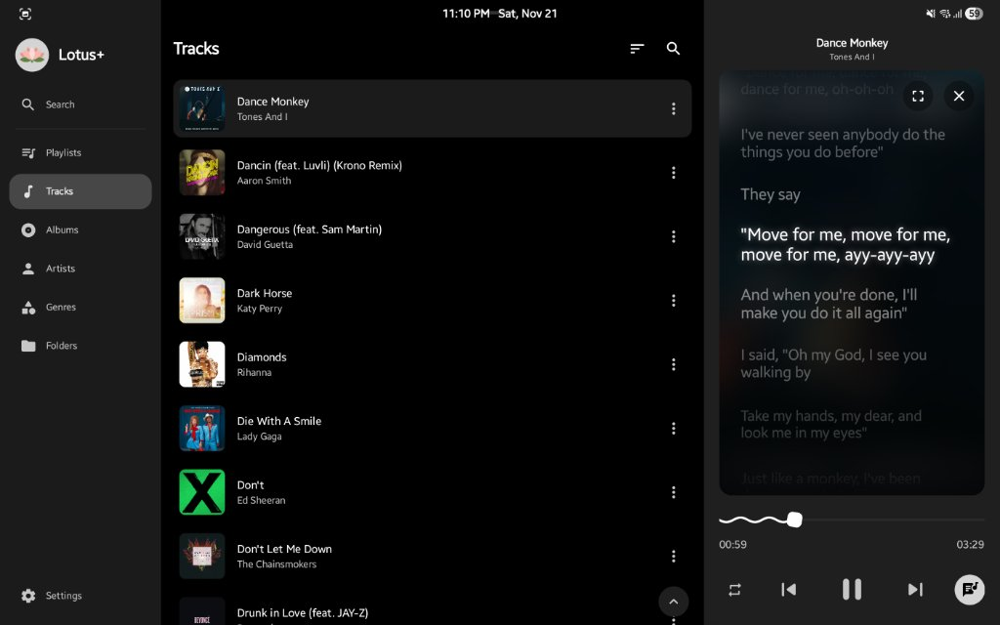
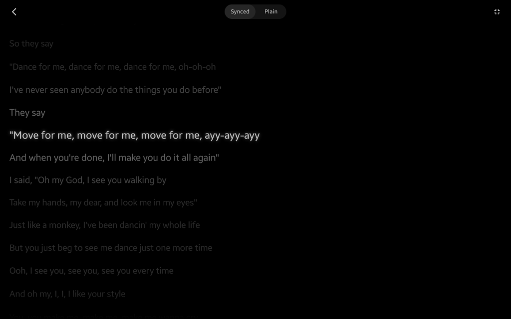
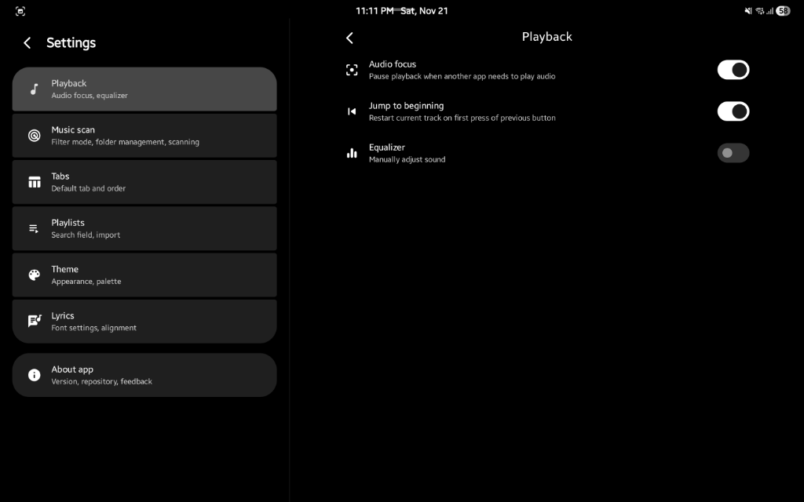

<div align="center">
  

  # Lotus+

  ### Music player for Android
  
</div>

## Screenshots

<div align="center">
  <div>
    
    
    
    
  </div>
</div>

## Tablet Support

<div align="center">
  <div>
    
    
    
    
  </div>
</div>

- Adaptive navigation rail with quick access to search, library tabs, and settings
- Persistent side player with expandable synchronized lyrics, compact top track header, and bottom playback controls
- Fullscreen lyrics view optimized for landscape and large screens
- Two-pane settings layout for faster navigation on tablets

## Features
- Enjoy your favorite music in a variety of formats, including MP3, FLAC, OGG, WAV, and more
- Easily browse tracks, albums, artists, genres, and folders, and create custom playlists
- Dynamic playlists for recently added and most played tracks
- Audio quality badge and detailed format, sample rate, and bitrate information
- Enhance your listening experience with smooth synchronized lyrics from [LRCLIB](https://lrclib.net/) and fullscreen lyrics mode
- Synchronized lyrics support for Android Auto
- Share single or multiple tracks directly from the player or library
- Manually update track details or fetch accurate info from [MusicBrainz](https://musicbrainz.org/)
- Designed with [Material You](https://m3.material.io/) and supports dynamic color palettes

## Download
Latest releases are available on [GitHub releases](https://github.com/FernandoNino38/Lotus-Plus/releases/latest)

Upstream Lotus is also available on [dn0ne/lotus](https://github.com/dn0ne/lotus) and [F-Droid](https://f-droid.org/packages/com.dn0ne.lotus)

## Support
If you enjoy using Lotus+, consider supporting the original author by [buying him a coffee](https://en.liberapay.com/dn0ne/donate)

## Build
1. **Get the Source Code**  
   - Clone the repository or download the source code:
     ```bash
     git clone https://github.com/FernandoNino38/Lotus-Plus.git
     ```

2. **Open project in Android Studio**  
   - Launch Android Studio.  
   - Select **File > Open** and navigate to the project's folder.  
   - Click **OK** to open the project.

3. **Run the project**  
   - Wait for the project to sync and build (Gradle sync may take some time).  
   - Ensure a device or emulator is connected.  
   - Click the **Run** button or press `Shift + F10` to build and launch the app.  

That's it! The app should now be running. 

## Credits
Some UI elements are inspired by [Vanilla](https://github.com/vanilla-music/vanilla)

Lyrics UI is inspired by [Beautiful Lyrics](https://github.com/surfbryce/beautiful-lyrics)

[MaterialKolor](https://github.com/jordond/materialkolor)

[kmpalette](https://github.com/jordond/kmpalette)

[Reorderable](https://github.com/Calvin-LL/Reorderable)

[jaudiotagger](https://bitbucket.org/ijabz/jaudiotagger/src/master/)

## License
Lotus+ is licensed under [GPLv3](LICENSE.md)
